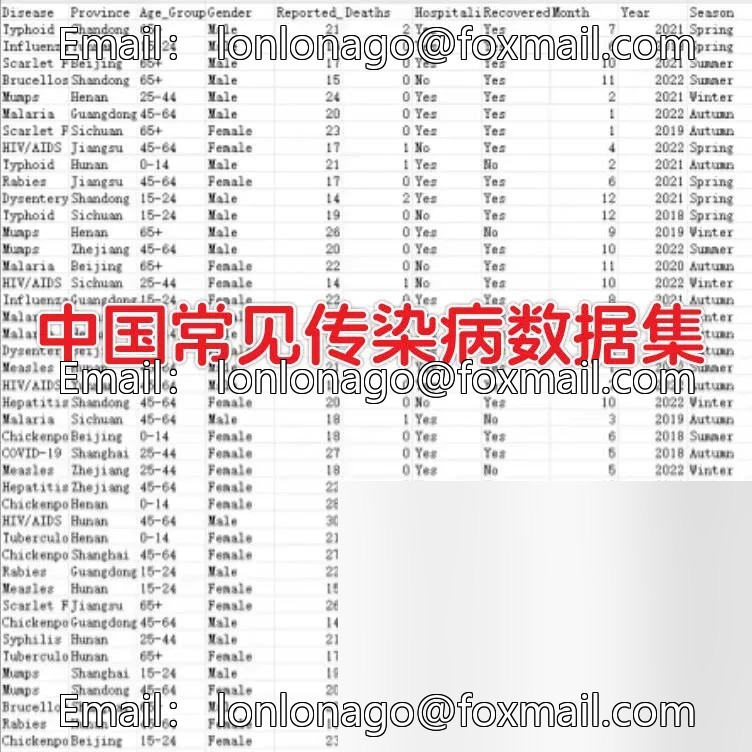
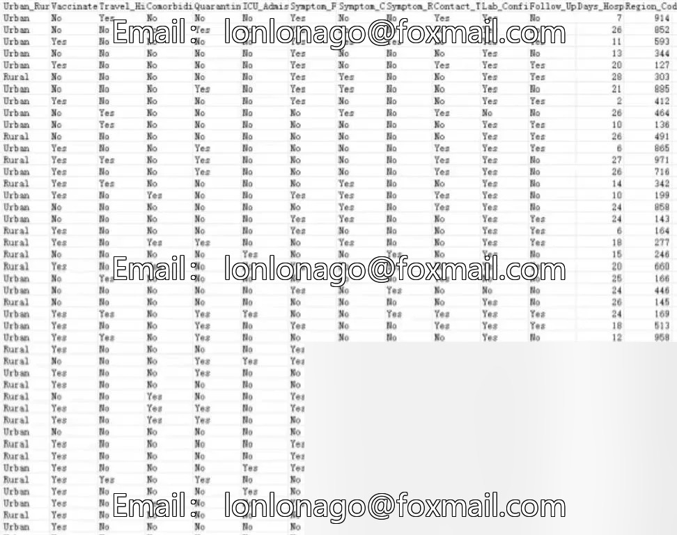

# Chinese common infectious disease dataset

## Body

Chinese common infectious disease dataset

The synthetic dataset includes 2,500 records from 25 fields, representing common infectious diseases such as tuberculosis, hepatitis B, influenza, and HIV/AIDS. It integrates demographic features (age, gender), clinical outcomes (hospitalization, death, ICU), geographical features (province, urban/rural), and social determinants (travel history, vaccination). It is based on patterns from publicly reported disease surveillance records (e.g., the monthly report of designated reportable infectious diseases) by the Chinese Center for Disease Control and Prevention, simulating disease surveillance records.

Field Description
​​Disease​​ Disease name
​​Province​​ Province
​​Age_Group​​ Age group
​​Gender​​ Gender
​​Reported_Cases​​ Reported cases
​​Deaths​​ Deaths
​​Hospitalized​​ Hospitalized
​​Recovered​​ Recovered
​​Month​​ Month
​​Year​​ Year
​​Season​​ Season
​​Comorbidity​​ Comorbidity
​​Quarantined​​ Is quarantined

​​ICU_Admission​​ Whether in ICU
​​Symptom_Fever​​ Fever symptoms
​​Symptom_Cough​​ Cough symptoms
​​Urban_Rural​​ Urban-rural classification
​​Vaccinated​​ Vaccination status
​​Travel_History​​ Travel history
​​Symptom_Rash​​ Rash symptoms
​​Contact_Tracing​​ Contact tracing
​​Lab_Confirmed​​ Lab-confirmed
​​Follow_Up​​ Follow-up status

Days_Hospitalized​​ Hospitalized Days
​​Region_Code​​ Region Code

web-based shipment, can be directly photographed and shipped.

The dataset spans 25 fields with 3,000 records covering disease names, provinces, age groups, genders, case and death counts, months, seasons and other related attributes.

<!-- AI_ENRICHED -->

## Images

## Payment

Here is a pay link on Stripe ( https://buy.stripe.com/3cs8yP7sY87d0vu9AB ). Please contact me lonlonago@foxmail.com after funding $89, and I will send you a complete data files , thank you!

